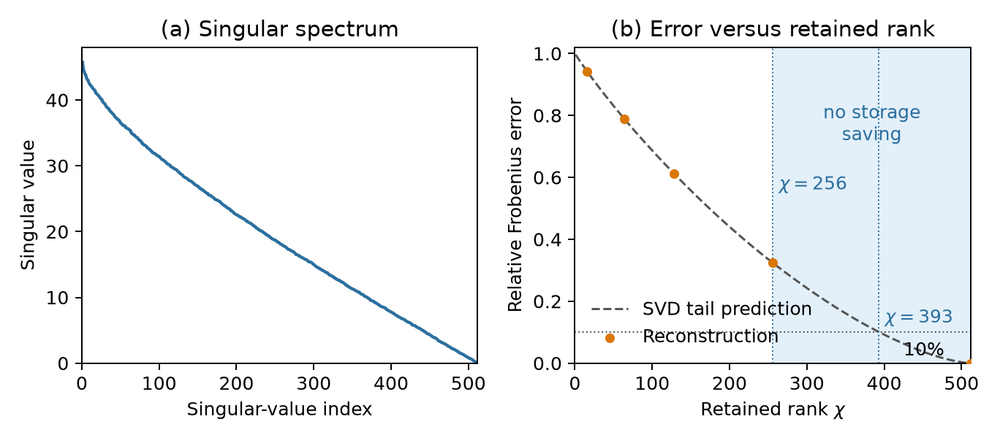
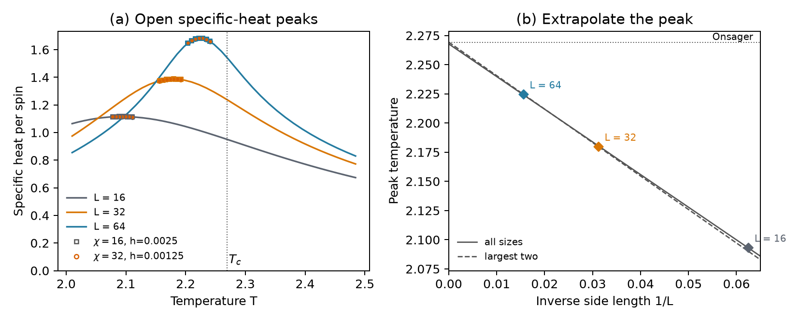
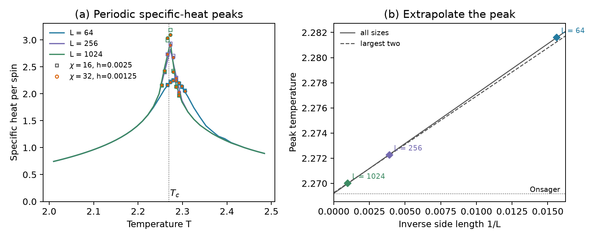

# Week 10: compression and Ising thermodynamics

This directory contains only the Week 10 requirements: the SVD evidence,
open-square boundary MPS, periodic TRG, their small-system checks, peak
refinement, and the three requested figures. It does not implement the optional
peak-height study.

## Model and data

The model is the zero-field square Ising model with
`H = -sum_edges s_i s_j`, `s_i = +/-1`, and `J = k_B = 1`. Boundary MPS uses
open edges; TRG uses periodic edges and counts one bond in each positive
direction. Thus the `L=2` torus has two parallel bonds for both the horizontal
and vertical nearest-neighbour pair.

The only input is the course Week 10 learning sheet. All numerical data are
generated locally by the Rust code. The TRG update follows the split and
regrouping structure linked in the sheet:
<https://github.com/GiggleLiu/BackwardsLinalg.jl/blob/b16273a2d695fef31334085e40f9e0341a1ec0f0/examples/trg.jl>.
The final closure is `sum_{i,j} A[i,j,i,j]`.

The site tensor is
`A[r,u,l,d] = sum_s W[s,r]W[s,u]W[s,l]W[s,d]` with
`W = [[sqrt(cosh K),sqrt(sinh K)],[sqrt(cosh K),-sqrt(sinh K)]]`.
An open bond closes with `b = [1/sqrt(cosh K),0]`.

## Environment

Tested on macOS 27.0.1 arm64 with Rust 1.98.1, Cargo 1.98.1, and Python
3.12.14. Rust dependencies are pinned in `Cargo.lock`; Python dependencies are
pinned in `requirements.txt`.

## Reproduction and verification

From this directory:

```bash
python3 -m venv .venv
.venv/bin/python -m pip install -r requirements.txt
cargo build --release --locked
cargo test --release
.venv/bin/python scripts/run_experiments.py --thermo target/release/thermo
.venv/bin/python scripts/analyze.py --check
```

`run_experiments.py` runs every required coarse and refined case, writes raw
evidence under `runs/`, then invokes the independent analyzer. To rerun existing
evidence, add `--force`. `cargo test --release` is the quick numerical gate;
`analyze.py --check` re-reads saved matrices and g values and exits nonzero if
any sheet tolerance fails. It also checks the `c_curve` implementation on the
analytic quadratic `g(K)=2+1.5(K-0.4475)^2`, where the returned curvature must
be `K^2*3`.

The sheet's two named commands can also be run after installation:

```bash
cargo install --path . --force
thermo --method boundary --l 64 --k 0.45 --chi 16 --out runs/boundary64
thermo --method trg --l 1024 --k 0.44 --chi 16 --out runs/trg1024
```

The sheet's `--method` syntax and the shorter `thermo boundary ...` /
`thermo trg ...` forms are both supported. `thermo svd` and `thermo exact`
generate the supporting evidence. Every periodic run executes
`n = 2 log2(L)` rounds and uses max-absolute-entry normalization; each boundary
run uses right-to-left canonicalization followed by a truncating left-to-right
sweep.

## Part 1: SVD evidence

The matrix is 512 by 512 with independent standard-normal entries. It uses seed
2026, `rand 0.8.8::StdRng` (ChaCha12) seeded by
`SeedableRng::seed_from_u64`, and `rand_distr 0.4.3::StandardNormal`.

The analyzer independently reads the saved matrix and each saved reconstruction.
The relative Frobenius errors and the discarded-spectrum predictions are:

| rank | measured error | SVD-tail prediction |
|---:|---:|---:|
| 16 | 0.9417078352472528 | 0.9417078352472528 |
| 64 | 0.7886688978602931 | 0.7886688978602933 |
| 128 | 0.6126465557654612 | 0.6126465557654615 |
| 256 | 0.3238417098812905 | 0.32384170988129063 |
| 512 | 7.578515590586458e-15 | 0 |

The largest measurement-prediction difference is `7.58e-15`. At rank 255 the two
thin factors store 261,375 entries; at rank 256 they store 262,400, so this is
the first rank that is not smaller than the original 262,144 entries. The
prediction first reaches 10% at rank 393, where storage is `1.5366554260` times
the original. Therefore this matrix has no storage-saving 10%-error truncation.



## Part 2: open boundary MPS

All g values use the coarse grid `K=0.40,0.4025,...,0.50`, `h=0.0025`,
`chi=16`. Nine-point refinement uses spacing `0.00125`. The final values use
`chi=32`; every other refined point gives the repeated wider-step estimate.

| L | T_peak chi=16 | T_peak chi=32 | peak c_V chi=32 | rank change | step change | chi=32 time (s) |
|---:|---:|---:|---:|---:|---:|---:|
| 16 | 2.0931049122 | 2.0931048452 | 1.1154480175 | 3.20e-8 | 1.44e-5 | 0.102 |
| 32 | 2.1796761166 | 2.1796762147 | 1.3875318316 | 4.50e-8 | 9.68e-6 | 0.891 |
| 64 | 2.2242193739 | 2.2245037266 | 1.6834748158 | 1.28e-4 | 1.66e-4 | 5.359 |

The `chi=32` fits `T_peak = T_c + a/L` give:

| sizes | T_c | relative difference from Onsager |
|---|---:|---:|
| 16,32,64 | 2.2677894114 | 0.06152% |
| 32,64 | 2.2693312385 | 0.00643% |



Open 4-by-4 small-system checks:

| case | chi | exact | MPS | abs error | tolerance |
|---|---:|---:|---:|---:|---:|
| g, K=0 | 8 | 0.6931471805599453 | 0.6931471805599453 | 0 | 1e-8 |
| g, K=0.44 | 8 | 0.8542220240137801 | 0.8542220240137681 | 1.20e-14 | 1e-8 |
| g, K=0.70 | 8 | 1.1317230403126313 | 1.1317230403126315 | 2.22e-16 | 1e-8 |
| c_V, K=0.44, h=0.0025 | 8 | 0.4393969121600853 | 0.4393930725435097 | 3.84e-6 | 1e-3 |

## Part 3: periodic TRG

The same coarse, refinement, rank, and step settings are used with the required
sizes. The final values are:

| L | T_peak chi=16 | T_peak chi=32 | peak c_V chi=32 | rank change | step change | chi=32 time (s) |
|---:|---:|---:|---:|---:|---:|---:|
| 64 | 2.2838438682 | 2.2816018552 | 2.2513920981 | 9.82e-4 | 1.55e-6 | 52.291 |
| 256 | 2.2725369621 | 2.2722601896 | 2.9038186908 | 1.22e-4 | 1.59e-4 | 98.265 |
| 1024 | 2.2708126956 | 2.2700124039 | 3.1620886060 | 3.52e-4 | 3.07e-4 | 162.462 |

The `chi=32` fits give:

| sizes | T_c | relative difference from Onsager |
|---|---:|---:|
| 64,256,1024 | 2.2692047215 | 0.000855% |
| 256,1024 | 2.2692631420 | 0.00343% |

The named `boundary64` run took 0.489 s and the named `trg1024` run took
0.805 s in the recorded evidence. Peak-refinement runs were executed in
parallel, eight at a time; their wall-clock solver times remain in every JSON
record and depend on contention.



Periodic small-system checks:

| case | chi | exact | TRG | abs error | tolerance |
|---|---:|---:|---:|---:|---:|
| L=2 g, K=0.44 | 16 | 1.0943416226313227 | 1.0943416226313230 | 2.22e-16 | 1e-8 |
| L=2 c_V, K=0.44, h=0.0025 | 16 | 0.4042782328079018 | 0.4042819375148952 | 3.70e-6 | 1e-3 |
| L=4 g, K=0.44 | 8 | 0.9690454086698483 | 0.9689397693774945 | 1.06e-4 | 2e-3 |

## Saved evidence

The three required figures are versioned in `artifacts/`. `data/` contains
the complete g tables with timings, refinement tables, checks, and machine-readable
summary. `runs/` contains every raw JSON run, including boundary normalization
scales and truncation diagnostics, each TRG scale/split factor/singular-value
history, final tensors, settings, `log Z`, g, and solver time. Generated data,
tensors, virtual environments, and build output are deliberately
ignored by Git.

The analyzer also recomputes `log Z` from the saved boundary cores and closes
the saved TRG tensor with `sum_{i,j} A[i,j,i,j]`; both independent checks must
agree with the saved value within `1e-12`.

The presentation tables are versioned with the figures: [boundary g values](data/boundary-g.csv),
[boundary refinement](data/boundary-refinement.csv), [TRG g values](data/trg-g.csv),
[TRG refinement](data/trg-refinement.csv), [small-system checks](data/checks.json),
and the [machine-readable summary](data/summary.json).

