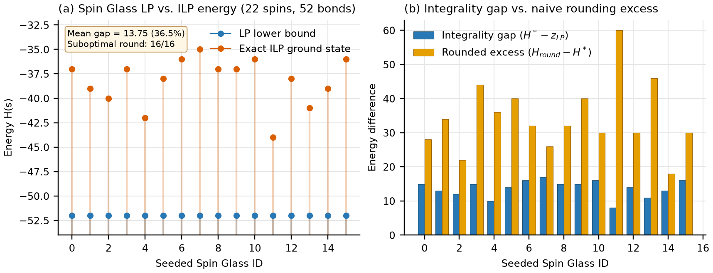
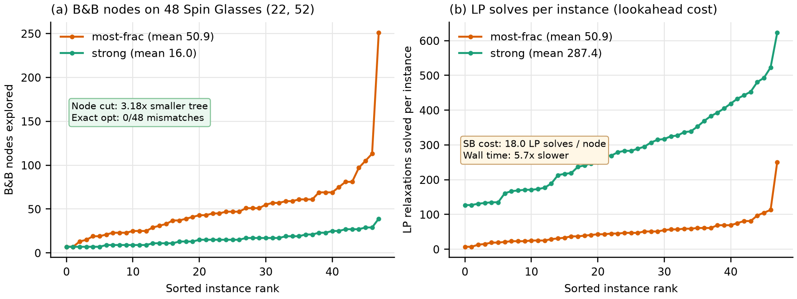
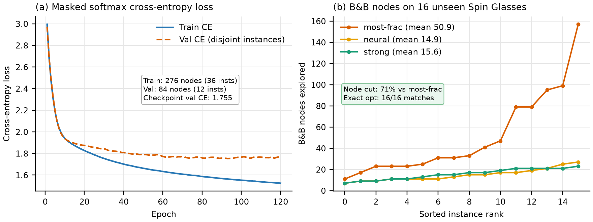
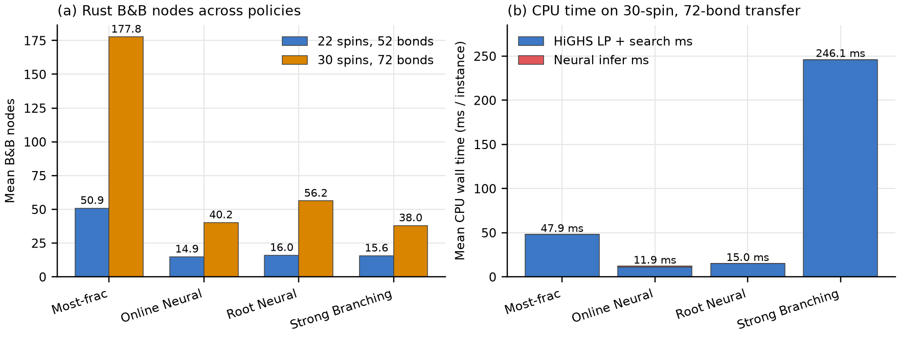

# Week 12: Integer programming and learned branching

This directory implements the required Week 12 spin-glass MILP, LP relaxation,
exact Branch-and-Bound, Strong Branching labels, JAX imitation model, Rust model
parity, and 22/30-spin evaluation. Raw runs and the trained model remain local;
the four required evidence figures are tracked with this README.

## Environment

Recorded on macOS arm64 with Rust 1.98.1, `uv` 0.12.9, Python 3.12.14,
`pred` 0.6.0, JAX 0.12.1, and the Rust `highs` crate 2.4.0. HiGHS is built with
presolve off and one thread. `uv` supplies CMake and the plotting dependencies
when the system does not provide them.

## Reproduction

Run from `week12/`:

```bash
cargo install problemreductions-cli@0.6.0 --locked
uv run --with cmake cargo test

mkdir -p artifacts/pred
(
  cd artifacts/pred
  pred create SpinGlass --graph 0-1,1-2,2-3,3-0 \
    --couplings=1,1,1,-1 -o square.json
  pred solve square.json
  pred create SpinGlass --random --num-vertices 100 --edge-prob 0.04 \
    --seed 2026 -o r100.json
  time pred solve r100.json
)

uv run --with cmake cargo install --path . --force
branchopt --mode gap --spins 22 --edges 52 --count 16 --seed 2026 \
  --out artifacts/gap
branchopt --mode bnb --spins 22 --edges 52 --count 48 --policy most-frac \
  --seed 2026 --out artifacts/bnb_most
branchopt --mode bnb --spins 22 --edges 52 --count 48 --policy strong \
  --export-labels --seed 2026 --out artifacts/bnb_strong

uv run --with jax==0.12.1 python train_branch.py \
  --dataset artifacts/bnb_strong/dataset.json --out artifacts/model.json
branchopt --mode eval --spins 22 --edges 52 --count 16 --seed 3026 \
  --model artifacts/model.json --out artifacts/eval_test
branchopt --mode eval --spins 30 --edges 72 --count 8 --seed 4026 \
  --model artifacts/model.json --out artifacts/eval_transfer

uv run --with matplotlib --with numpy python plot_evidence.py
```

The instance generator, MILP, search rules, labels, network, and timing
definitions are recorded in `branchopt.design.toml` and
`train_branch.design.toml`. Three seed values are used across the four study
groups: `2026` for gap, both B&B policies, and training; `3026` for the unseen
22-spin evaluation; and `4026` for the 30-spin transfer.

## Results

The opening square gives LP bound `-4`, exact energy `-2`, and rounded energy
`+2`; the diet optimum is `23.0714285714`. The 16-instance gap run gives mean LP
bound `-52.0`, exact energy `-38.25`, integrality gap `13.75`, and rounding
excess `34.25`, with all 16 roundings suboptimal. The mean per-instance relative
gap is `36.5%`.

On 48 spin glasses, most-frac explores `50.875` nodes and LP solves per instance;
Strong Branching explores `16.0` nodes with `287.417` LP solves, a `3.18x`
smaller tree and a measured `5.6x` wall-time cost. Both match HiGHS exactly.
The tetrahedron trace visits 5 nodes with bounds
`-6, -4, -3 (incumbent), -3 (pruned), -2 (pruned)`.

Training uses 276 nodes from 36 instances and validates on 84 nodes from 12
disjoint instances. Best checkpoint epoch 95 has validation CE `1.754824`;
top-1 label accuracy is `77.5%` on training nodes and `73.8%` on validation
nodes. Rust matches all 6 JAX probes to `3.33e-16`. On 16 unseen 22-spin
instances, most-frac/neural/root-neural/Strong require
`50.875 / 14.875 / 16.0 / 15.625` mean nodes and
`9.244 / 3.004 / 2.964 / 52.870` ms per search. On 8 larger 30-spin instances
they require `177.75 / 40.25 / 56.25 / 38.0` mean nodes and
`47.867 / 11.940 / 14.967 / 246.074` ms per search. Every energy error is zero,
every non-Strong LP-solve count equals its node count, and both neural rules are
faster than Strong Branching on both sizes.

## Evidence

The `pred` inputs and solve logs, trained [model](artifacts/model.json), label
[dataset](artifacts/bnb_strong/dataset.json), run summaries, and printed output
are versioned with the figures. They provide the actual Strong Branching labels,
JAX/Rust probes, node counts, timings, and training history used below:

- [square problem](artifacts/pred/square.json) and [solution](artifacts/pred/square-solve.txt)
- [100-spin problem](artifacts/pred/r100.json), [solution](artifacts/pred/r100-solve.txt), and [timing](artifacts/pred/r100-time.txt)
- [gap run](artifacts/gap/run.json), [most-frac run](artifacts/bnb_most/run.json), [Strong Branching run](artifacts/bnb_strong/run.json)
- [22-spin evaluation](artifacts/eval_test/run.json) and [30-spin transfer](artifacts/eval_transfer/run.json)
- [training output](artifacts/train-stdout.txt) and saved [model](artifacts/model.json)

The four figures are generated only by `plot_evidence.py` from these saved runs.








