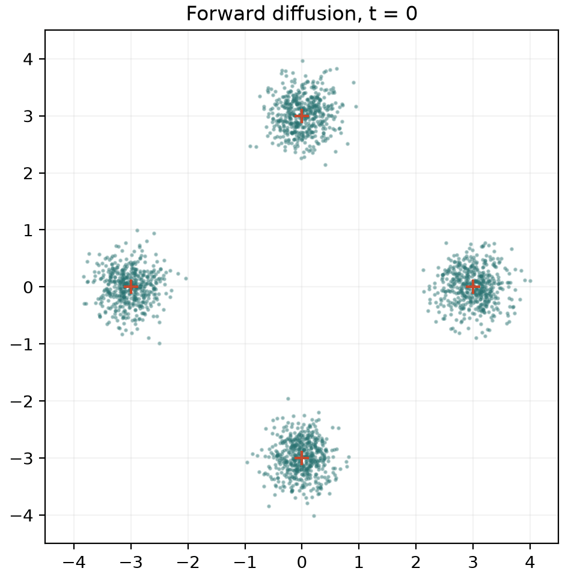
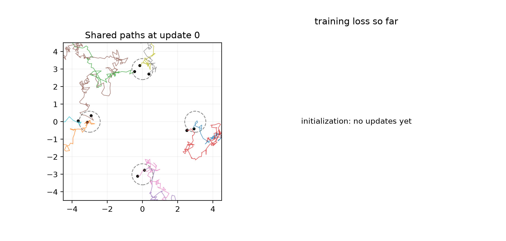
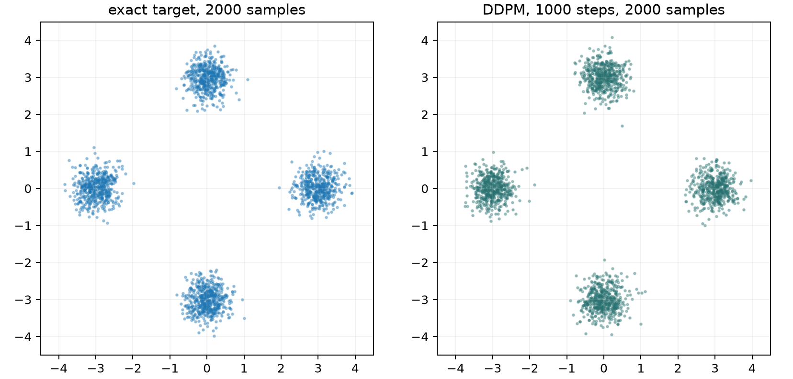
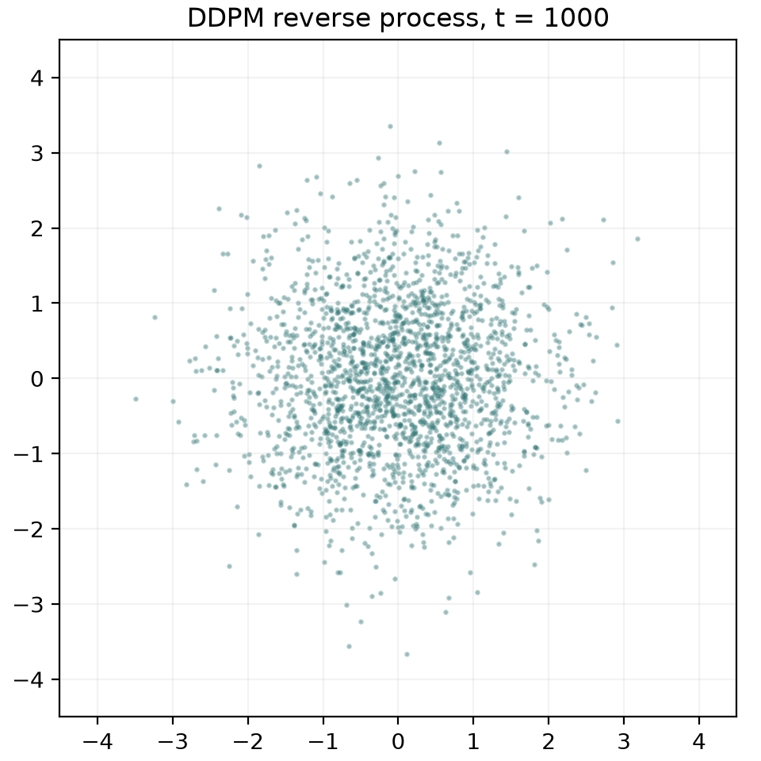
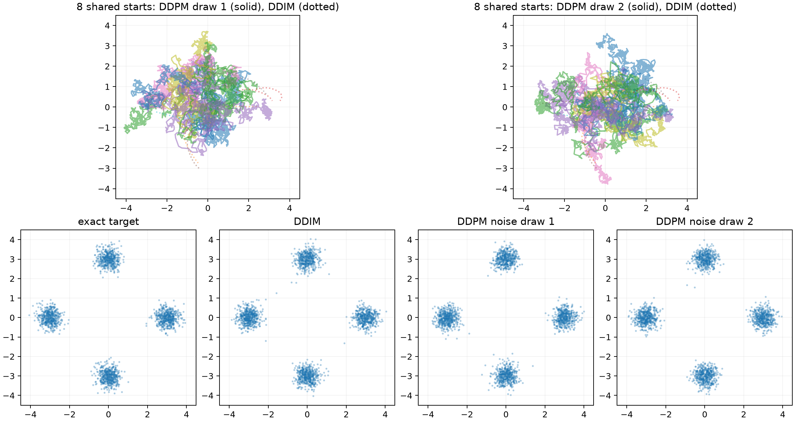
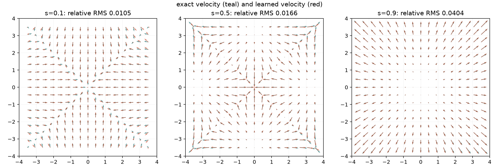
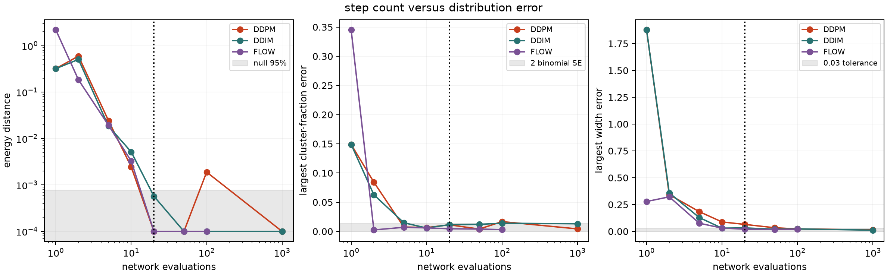
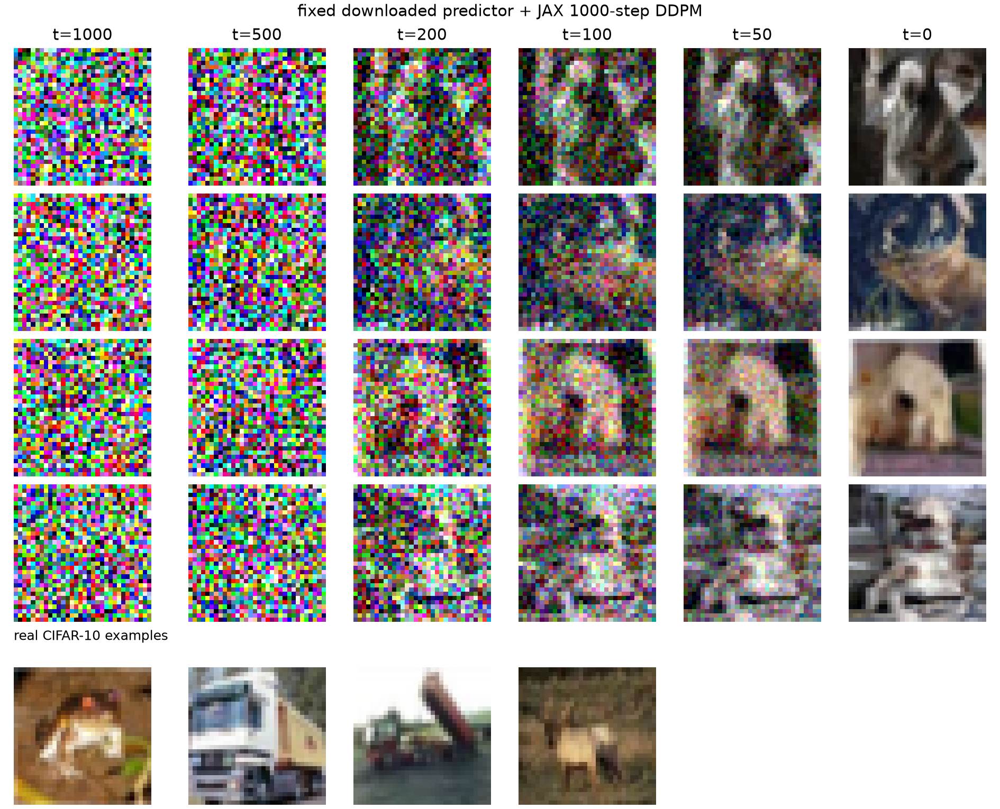
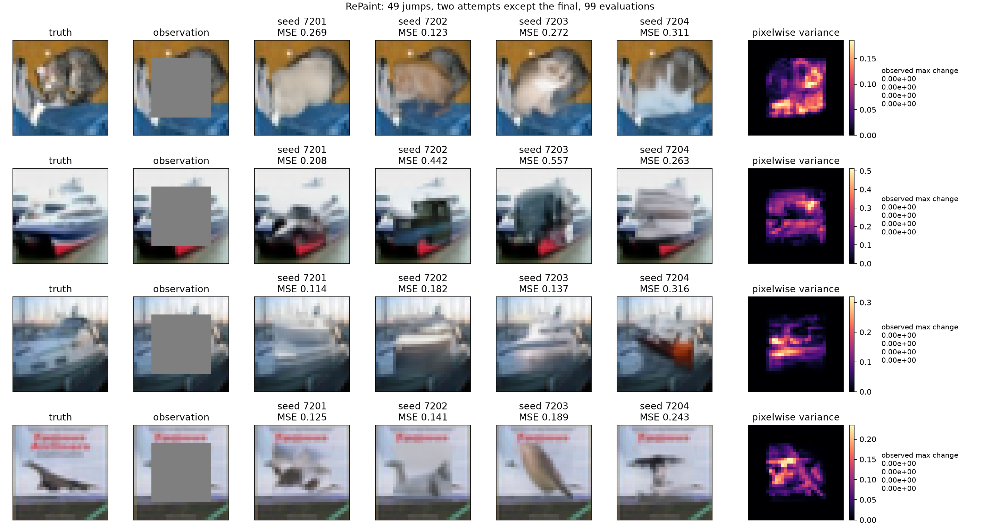

# Week 7: diffusion and flow matching

This week implements the four-cluster diffusion and flow-matching studies, a
pure-JAX loader and sampler for the fixed CIFAR-10 U-Net, and RePaint.  Every
figure below was produced by the command immediately preceding it.  Run all
commands from `week7/`.

## Environment and layout

The environment uses CPU-only JAX with float32 arrays and `uv`:

```bash
uv sync
.venv/bin/python -c "import jax,numpy,matplotlib; \
  print(jax.__version__, numpy.__version__, matplotlib.__version__, jax.devices())"
```

It was verified with Python 3.12.14, uv 0.12.9, JAX 0.12.0 (CPU),
NumPy 2.5.4 and Matplotlib 3.11.2.  `diffusion.toml` and `flow.toml` are the
learning sheet's setting blocks.  `inputs/`, `artifacts/` and `.venv/` are
git-ignored; checkpoints, model weights and raw runs stay local.

```text
week7/
  diffusion.toml, flow.toml    experiment settings
  scripts/diffusion_lib.py     target, networks, DDPM, DDIM and metrics
  scripts/run_diffusion.py     Part 1 training and checkpoints
  scripts/diffusion_evidence.py Parts 1-2 figures and metrics
  scripts/run_flow.py          Part 3 training
  scripts/flow_evidence.py     Part 3 velocity and sampler comparison
  scripts/unet_jax.py          pure-JAX Diffusers v0.40.0 U-Net translation
  scripts/run_cifar.py         Part 4 generation
  scripts/run_repaint.py       Part 5 inpainting
  scripts/download_inputs.sh   images, real CIFAR-10 and pinned model
  tests/                       focused formula and contract checks
  evidence/                    committed deliverables
  artifacts/, inputs/          generated and ignored
```

`make reproduce` downloads the inputs, retrains both small networks, runs the
four-image 1000-step generations and runs RePaint.  `make test` does not need
the 136 MB checkpoint; its checkpoint test is skipped if the model is absent.

The CIFAR predictor is pinned to
`google/ddpm-cifar10-32@267b167dc01f0e4e61923ea244e8b988f84deb80`.
The measured SHA-256 values are
`1558dbe3fb093b0857d473e376b711eeda1b186c557be5e85b3a56300cd49f0f`
for the safetensors file and
`49579448cd5728fb83f14186de12464eee143d2f5dccb11b8e13744d712eae9d`
for `config.json`.

## Part 1: DDPM on the Gaussian mixture

`run_diffusion.py` trains for 25,000 updates with seed 2026 and writes all ten
specified checkpoints.  The measured training time was 15.6 s and the final
loss was 0.24495.  Reverse steps use the effective jump variance `1-a`, no
clipping, and no noise on the final jump.

At `t=1000`, the same 2000 forward samples have coordinate mean
`(0.0083, -0.0243)` and variance `(1.0054, 1.0139)`, both within the required
0.1.  All ten checkpoints use the same ten Gaussian starts and the same full
reverse-noise sequence.  The final 2000-sample DDPM run gives populations
`0.2425, 0.2520, 0.2545, 0.2510`, widths 0.2862--0.3153, and maximum errors
0.0075 (population), 0.0257 (centre), 0.0153 (width), all inside the sheet's
limits.

```bash
.venv/bin/python scripts/run_diffusion.py
.venv/bin/python scripts/diffusion_evidence.py part1
```






## Part 2: deterministic DDIM

The same trained predictor supports any decreasing level grid.  The network
always receives the original level `t`, never the jump counter.  Tweedie's
clean estimate is followed by the deterministic DDIM recombination; the exact
mixture conditional-mean predictor is available through the same code path.

Two full DDIM runs share a start and differ by exactly `0.0`.  Two DDPM runs
with different reverse noise diverge while still reproducing the target.  The
two DDPM endpoints land in the same cluster for only 0.2475 of the shared
starts.  DDIM's maximum population/centre/width errors are
0.0105/0.0216/0.0170; DDPM noise draw 1 gives 0.0070/0.0330/0.0125 and draw 2
gives 0.0100/0.0283/0.0094.

```bash
.venv/bin/python scripts/diffusion_evidence.py part2
```



## Part 3: flow matching and transport cost

The velocity network uses seed 2029, the same width/optimizer contract and
25,000 actual updates.  Its measured training time was 15.4 s and final loss
2.72666.

Against the exact marginal field, the relative RMS errors at
`s=0.1,0.5,0.9` are 0.01045, 0.01660 and 0.04039; all are below 0.1.
Every comparison run uses 4000 samples.  The null 95% energy-distance scale,
estimated from 20 independent exact-vs-exact pairs, is 0.000777.  At 20 steps,
flow matching reaches energy distance -0.000070 and maximum width error
0.0208, satisfying both required checks.  In this run DDIM at 20 steps has
energy distance 0.000572 and width error 0.0324, while DDPM first gets below
the 0.03 width tolerance at 100 steps.  Thus flow/DDIM need tens of Euler
evaluations, whereas the stochastic DDPM schedule needs substantially more.

```bash
.venv/bin/python scripts/run_flow.py
.venv/bin/python scripts/flow_evidence.py
```




## Part 4: fixed CIFAR-10 predictor

`unet_jax.py` transposes the published convolution/linear weights to JAX
layout, implements the Diffusers v0.40.0 GroupNorm, residual, attention and
`downsample_padding=0` behavior, and keeps all model weight arrays fixed.
The checkpoint learned the unconditional photo prior.  The sampler computes
the reverse recurrence in this repository, with mathematical level `t` passed
to the model as `t-1`, unclipped float32 states, and clipping only for display.
Four 1000-step generations took 51.4 s on CPU.  The four real comparison
images come from Week 6's `datasets.read_cifar10()`.

```bash
.venv/bin/python scripts/run_cifar.py
```



## Part 5: RePaint

The sampler receives only the observed image and mask.  It visits
`1000,980,...,20,0`, retries each jump once after forward-noising the merged
state, and takes the final jump once: exactly 99 network evaluations per seed.
For each of four images it uses seeds 7201--7204 and replaces observed pixels
with forward-noised observations after every attempt.
The mean hidden-pixel MSE is 0.2431 (per-completion range 0.114--0.557), close
to the sheet's reference scale but not treated as a threshold.  The mean
pixelwise variance in the 20x20 hole is 0.0818, so different seeds produce
different content.  Every observed pixel is unchanged: the largest observed
difference is exactly 0.0, below `10^-5`.

```bash
.venv/bin/python scripts/run_repaint.py
```



## Verification

```bash
make test
```

The 16 tests cover the schedule/config, initialization, forward endpoint,
DDPM's noiseless final step, deterministic DDIM, exact predictor shapes,
flow features and exact field endpoint, checkpoint loading/finite forward,
RePaint's 99-evaluation schedule and its proposal formula.  The submitted
figures and measured JSON values above come from the complete runs, not from
test fixtures.
