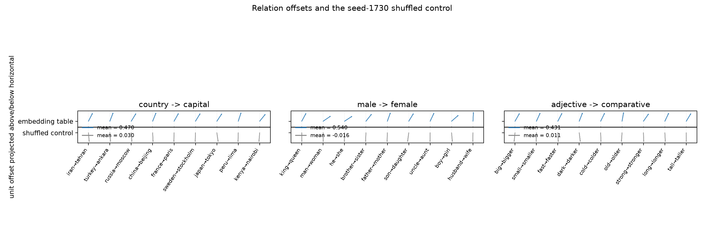
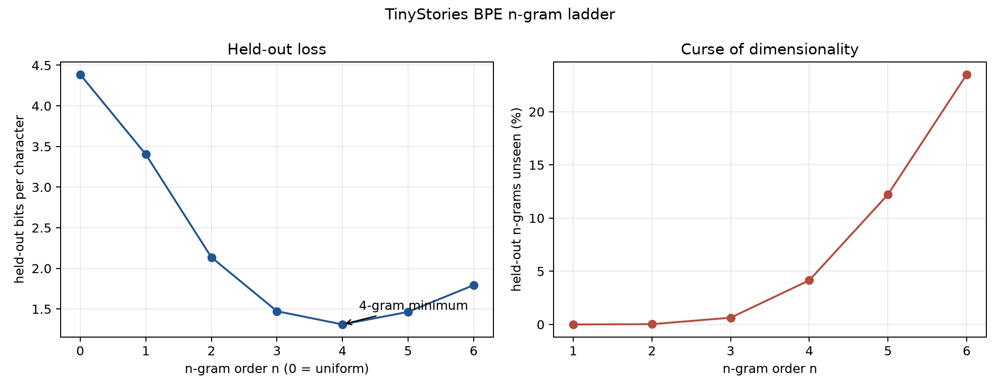
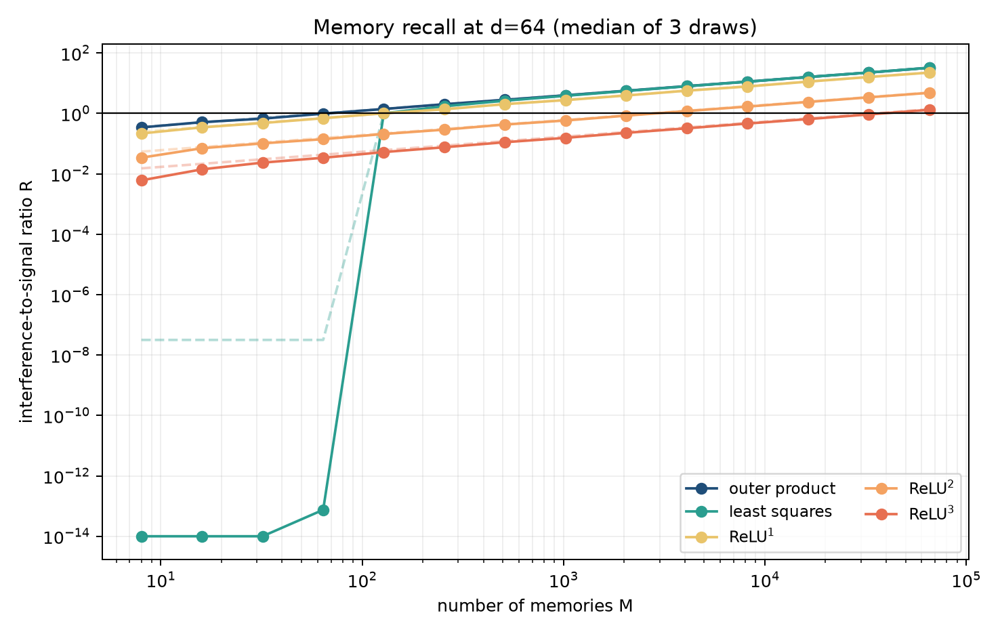
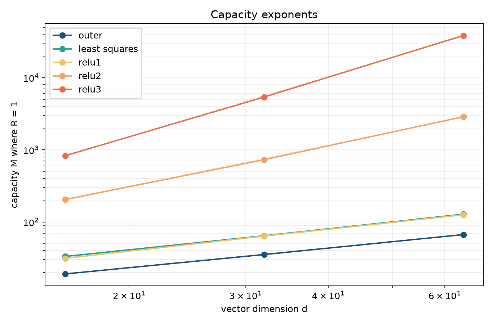
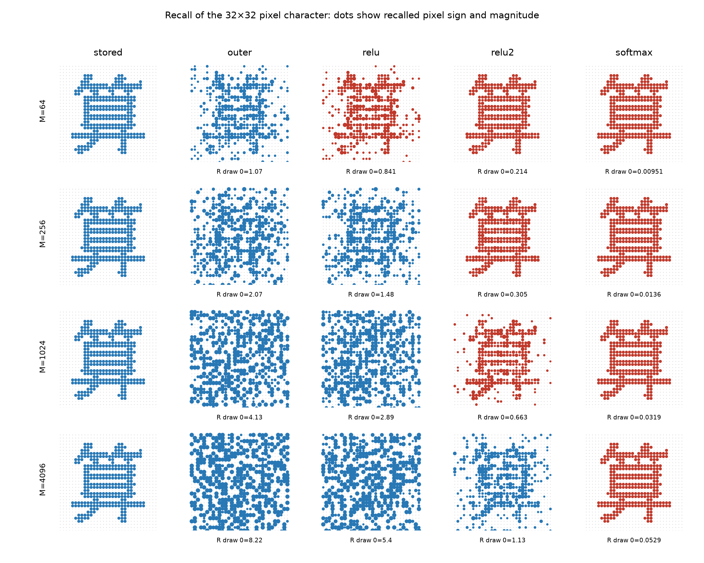
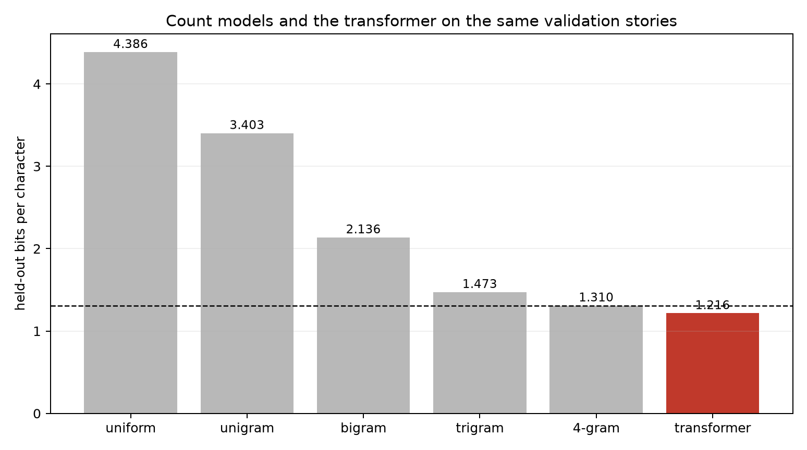
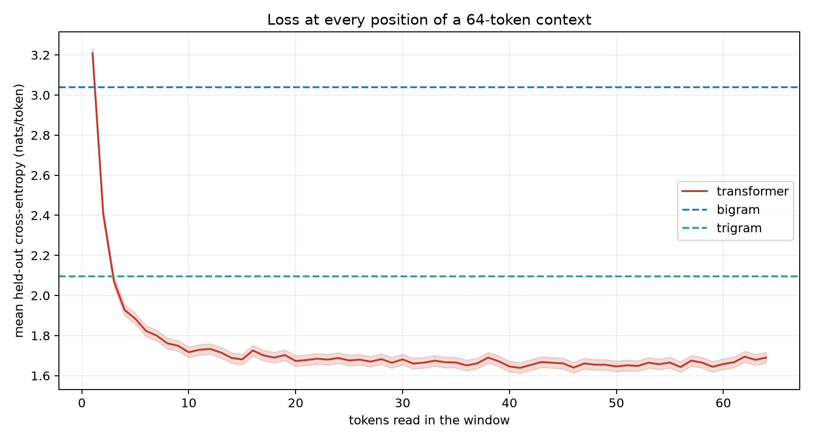
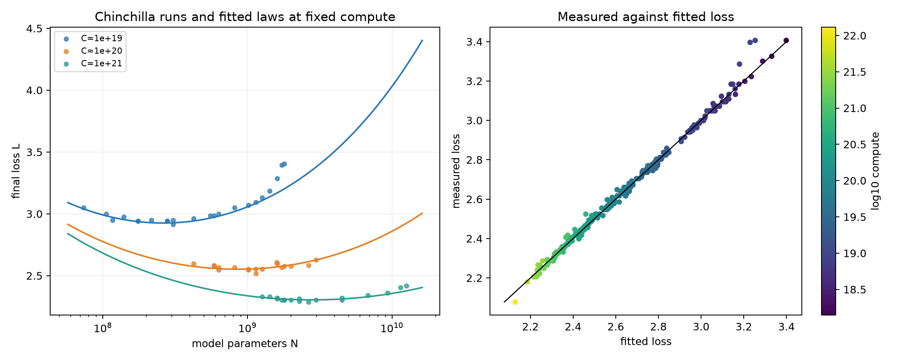
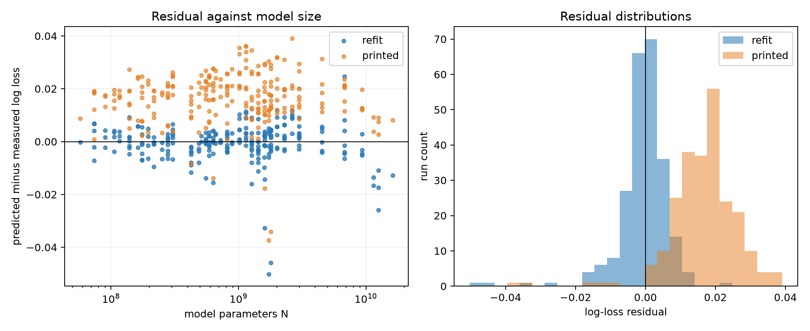
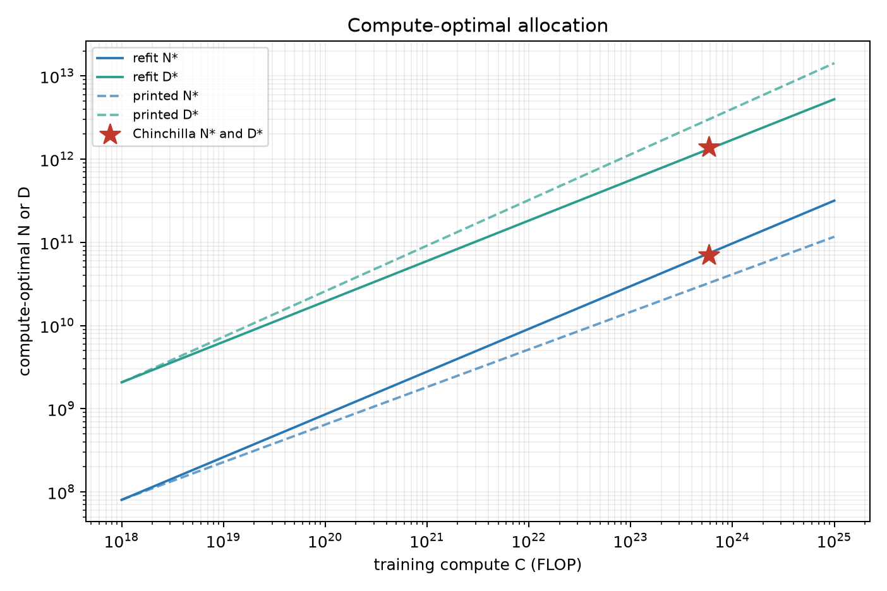

# Week 8: language models and the transformer

This directory implements the required DO and VERIFY tasks in all six Parts of
the Week 8 learning sheet.  Extensions are intentionally omitted.  Every figure
below comes from the command immediately before it, and every numerical claim
is stored by the corresponding run in `artifacts/part*-metrics.json` (ignored by
git).  Run commands from this directory.

## Environment and layout

The environment uses Python 3.12.14, `uv`, CPU-only JAX 0.12.0.1, NumPy 2.5.4,
SciPy 1.18.1, SentencePiece 0.2.2, and Matplotlib 3.11.2.

```bash
uv sync
make data
make test
make reproduce
```

`evidence/` contains the ten deliverable evidence figures.  `data/`, `inputs/`,
`artifacts/`, and `.venv/` are git-ignored: they contain the corpus, pinned
downloads, raw metrics, bootstrap samples, and checkpoints.

```text
week8/
  settings.toml                 all experiment settings
  Makefile                      data / reproduce / test entry points
  scripts/download_inputs.sh    pinned downloads
  scripts/part1_embeddings.py   embedding geometry and shuffled control
  scripts/part2_ngrams.py       BPE corpus, n-grams, sampling test
  scripts/part3_memory.py       associative memories and one-token MLP
  scripts/part4_attention.py    32x32 picture recall
  scripts/transformer_lib.py    pure-JAX transformer and sampler formulas
  scripts/part5_transformer.py  training, generation, verification
  scripts/part6_scaling.py      Chinchilla fit, bootstrap, allocation
  tests/                        focused formula and contract tests
```

The top-level repository's historical convention says `figures/`; this task's
explicit contract requires `evidence/`, which is used here.

## Pinned inputs

The download script writes these exact resources:

```text
TinyStories
URL  https://huggingface.co/datasets/roneneldan/TinyStories/resolve/f54c09fd23315a6f9c86f9dc80f725de7d8f9c64/TinyStoriesV2-GPT4-valid.txt
rev  f54c09fd23315a6f9c86f9dc80f725de7d8f9c64
sha  6874bae9a4c1a4e7edcf0e53b86c17817e9cf881fc75ff2368da457b80c0585d

tok512 SentencePiece
URL  https://huggingface.co/karpathy/tinyllamas/resolve/0bd21da/stories260K/tok512.model
rev  0bd21da
sha  dfff07d929db979913f166ec94a6f5ecad4c70cfed8eb5c9cbe7e464455e46f5

potion-base-8M embeddings
URL  https://huggingface.co/minishlab/potion-base-8M/resolve/bf8b056/model.safetensors
rev  bf8b056
sha  f65d0f325faadc1e121c319e2faa41170d3fa07d8c89abd48ca5358d9a223de2

potion tokenizer
URL  https://huggingface.co/minishlab/potion-base-8M/resolve/bf8b056/tokenizer.json
rev  bf8b056
sha  e67e803f624fb4d67dea1c730d06e1067e1b14d830e2c2202569e3ef0f70bb50

Chinchilla extracted runs
URL  https://raw.githubusercontent.com/epoch-research/analyzing-chinchilla/92258837425e1b5f2851d624287f0120583a3d0e/data/svg_extracted_data.csv
rev  92258837425e1b5f2851d624287f0120583a3d0e
sha  193478df4e90f040016431996c45682659306840ecdadf83cfb9cd5ca0aa1b30
```

## Part 1: embeddings

The Model2Vec file is read directly as a `29,528 x 256` safetensors array; no
PyTorch dependency is used.  Word rows are normalized, pair offsets are formed,
and each pair is compared with the leave-one-out mean of the other eight
offsets.  Seed 1730 makes the primary shuffled table; 20 further shuffles test
the control's stability.  Each arrow has unit length; its horizontal endpoint
is exactly the pair's cosine.

| relation | table mean cosine | seed-1730 control | max abs over 20 controls |
|---|---:|---:|---:|
| country to capital | 0.4701 | 0.0300 | 0.0910 |
| male to female | 0.5396 | -0.0157 | 0.0628 |
| adjective to comparative | 0.4312 | 0.0110 | 0.0852 |

All table means exceed 0.3 and every shuffled mean stays inside ±0.15.

```bash
.venv/bin/python scripts/part1_embeddings.py
```



## Part 2: count models and the tokenizer

The corpus is split only at `<|endoftext|>`, stripped, and cleaned of empty
stories.  Its first 24,867 stories train and 2,763 validate.  `tok512.model` is
a 512-entry SentencePiece model with three special tokens and 256 byte
fallbacks.  A leading EOS supplies the first context and EOS separates every
story.  There are 2.05183 validation characters per predicted token.  Decoding
returns all validation stories except three where the tokenizer merged a double
space, as expected by the sheet.

The add-k candidates are selected on an inner final 10% of the training token
stream, not on validation.  The selected values are 0.0001 (unigram), 0.01
(bigram through 5-gram), and 0.001 (6-gram).  Counts and row normalizers use the
same packed context order.

| model | nats/token | perplexity | bits/character | unseen held-out n-grams |
|---|---:|---:|---:|---:|
| uniform | 6.23832 | 512.000 | 4.38633 | 0.000% |
| unigram | 4.83940 | 126.394 | 3.40271 | 0.000% |
| bigram | 3.03819 | 20.867 | 2.13623 | 0.027% |
| trigram | 2.09434 | 8.120 | 1.47258 | 0.633% |
| 4-gram | 1.86275 | 6.441 | 1.30974 | 4.151% |
| 5-gram | 2.08252 | 8.025 | 1.46427 | 12.224% |
| 6-gram | 2.55038 | 12.812 | 1.79323 | 23.499% |

Explicit sums over all token sequences of lengths 1, 2, and 3 have errors
`2.22e-16`, `1.78e-15`, and `2.44e-15`.  A 250,000-token ancestral bigram walk
passes the 20 independent context tests combined by adding their chi-square
statistics and degrees of freedom (`chi2=1192.67`, `df=1211`, `p=0.6409`); the
genuine two-places-back negative control has `p=0`.

```bash
.venv/bin/python scripts/part2_ngrams.py
```



## Part 3: memories in weights

The memory experiments use random unit keys and values, three independent
draws, and the median over up to 256 stored query keys per draw.  For the
least-squares store, the fitted prediction is decomposed in the stored-value
basis: its diagonal coefficient is signal and all off-diagonal coefficients are
interference.  This is the decomposition that gives the sheet's capacity near
`2d`.

At `d=64`, the outer store crosses `R=1` at 66.86 memories, least squares at
128.21, ReLU² at 2,881.64, and ReLU³ at 38,520.59.  The measured capacity
slopes for outer/layers/ReLU/ReLU²/ReLU³ are 0.906/0.973/1.003/1.906/2.769.
The least-squares ratio is below `7.51e-14` through 64 memories, and all five
d=64 curves have log-log slope near 1/2 after `R>0.1`.

The one-token model has a 64-wide learned embedding, 512 tanh units, and a
512-token softmax readout.  It ran 4,000 AdamW steps with 16,384 sampled pairs
per step, peak learning rate 0.006, warmup, and cosine decay.  Its held-out loss
is 3.04181 nats/token, only +0.00361 above the Part 2 bigram.

```bash
.venv/bin/python scripts/part3_memory.py
```





## Part 4: recalling a picture from text-like memories

The character **算** is rendered to 32x32 pixels, thresholded to +1 ink and -1
background, then stored as one value among random ±1 pictures.  Keys have
d=64.  Each recall is divided by the stored picture's own weight before visual
rendering.  That is why the softmax column remains crisp as M grows: its own
weight sharply suppresses the unrelated memories.

The 20-draw median interference ratios, used for acceptance, are:

| memories M | outer | ReLU | ReLU² | softmax, beta=8 |
|---:|---:|---:|---:|---:|
| 64 | 1.024 | 0.717 | 0.140 | 0.0064 |
| 256 | 2.028 | 1.432 | 0.307 | 0.0142 |
| 1,024 | 3.959 | 2.826 | 0.600 | 0.0281 |
| 4,096 | 8.106 | 5.663 | 1.226 | 0.0567 |

The softmax store stays below 0.1 at every M; ReLU² crosses one only beyond its
capacity.  The number under each displayed recall is that draw-0 recall's exact
R; red dots mark recalls with `R<1`.

```bash
.venv/bin/python scripts/part4_attention.py
```



## Part 5: the Transformer and sampling

The decoder is pure JAX with pre-norm residual blocks: two layers, width 96,
four heads, context 64, 384-wide GELU MLPs, learned position vectors, and a
bias on every linear map.  It was trained from scratch for 6,000 AdamW steps
with batches of 32 sequences, peak learning rate 0.003, 300 warmup steps, and
cosine decay to one tenth.  The disclosed global-gradient-norm clip is 1.0.

Complete held-out scoring covers all 1,078,996 validation targets.  It gives
1.72933 nats/token and **1.21593 bits/character**, beating the 4-gram's 1.30974.
The mean over positions 32--64 is 1.66184 nats; the last eight positions average
1.67168 nats, both below the trigram's 2.09434.

All count-model and Transformer samples use exactly 60 non-EOS tokens with EOS
excluded and are ordered by held-out BPC:

| bits/char | model | measured sample |
|---:|---|---|
| 1.2159 | Transformer | `One park named Tom went to the garden. He saw a red tree with a ring. Tom went for a game! He saw a new leg outside on a flumber` |
| 1.3097 | 4-gram | `Lily liked the idea to t\ufffd d\t\ufffd/5myithBgch\ufffdb\ufffd bev\ufffdfd\ufffd On> so(\ufffdP\ufffd\ufffd saidrE\ufffdd""Z”\x1c\ufffdnts play m\u07957\x19 namedy` |
| 1.4726 | trigram | `Lily liked to do you thin b\ufffd4 d\t\ufffd/5myithBgch\ufffdb\ufffd bev\ufffdfd\ufffd On> so(\ufffdP\ufffd\ufffd saidrE\ufffdd""Z”\x1c\ufffdnts play more to shar` |
| 2.1362 | bigram | `Lily, there was very mad she a som we worited with it. Mick. She said. She flealan's the pris plag wat bared. re with elewing unt and anor` |
| 3.4027 | unigram | `spd to.etingonheheedent a g theedae.wr playumye he Heoureked cAd the epingotey b grendndcc s go ca had oided ss p` |
| 4.3863 | uniform | `C\x19\ufffdR\ufffd for he> weHo\ufffd L\ufffd t\ufffded\x06 B\x07 On4\ufffd dv\t\ufffd\ufffd m/\ufffd5idmy\ufffdith\ufffdB\ufffdg toch \ufffd6bent\ufffdR betv<\ufffd\ufffdf\x18d\ufffd\ufffd` |

The count samples start from a real observed story boundary whose context ends
in EOS.  Their eventual byte fallback is expected from pure add-k counting once
a generated higher-order context has never appeared in training; no backoff is
hidden in the model.

```bash
.venv/bin/python scripts/part5_transformer.py
```





The sampled sampler settings were: temperature 0.8; top-k 20 at temperature
0.8; top-p 0.9 at temperature 0.8, including the token crossing the threshold;
and min-p 0.1 at temperature 0.7.  With 100,000 draws each, the chi-square
p-values were 0.3235, 0.4307, 0.3641, and 0.5508.  Temperature 0.0001 chose the
argmax in all 1,000 trials.  A top-p sampler that wrongly drops the crossing
token has `p=0`.

Self-consistency used 128 independent sequences of length 128.  At temperature
1, mean surprise minus mean predicted entropy gives `z=1.020`.  Sampling at
temperature 0.7 and scoring with the temperature-1 model gives `z=-72.69`.

## Part 6: Chinchilla scaling

The CSV contains 245 extracted runs.  The five highest-loss runs are removed,
leaving 240.  Tokens are computed as `D=C/(6N)`.  The fit minimizes the sum of
the Huber loss on `log L` with `delta=0.001`; L-BFGS starts from the sheet's
grid over `alpha`, `log E`, and shared initial `log A = log B`.

| parameter | refit | 400-bootstrap SE |
|---|---:|---:|
| E | 1.81722 | 0.02643 |
| A | 477.826 | 121.236 |
| B | 2,143.417 | 1,398.465 |
| alpha | 0.34731 | 0.01540 |
| beta | 0.36717 | 0.02255 |

The fitted-law mean log residual is -0.000656; the printed-law residual is
+0.016742, showing that the published parameters miss these runs.  At
`C=5.76e23`, the refit gives `N*=73.19B`, `D*=1.311T`, and **17.92 tokens per
parameter**.  The 400-resample 95% interval for `D*/N*` is 7.08--37.66 and
contains Chinchilla's 20.  The fitted allocation slopes are 0.514 for N* and
0.486 for D*.  The printed parameters instead imply 92.65 tokens/parameter.

```bash
.venv/bin/python scripts/part6_scaling.py
```







## Verification

```bash
make test
```

The 18 focused tests cover the exact settings, leave-one-out relation scores,
unit arrow geometry, n-gram packing and EOS alignment, exact sequence
normalization, per-context chi-square combination, memory interference and
capacity interpolation, softmax picture recall, Transformer shape/biases and
causality, all sampler masks and the greedy limit, EOS-excluding count
sampling, the scaling-law gradient at an exact fit, and the compute-optimal
equations.

`make reproduce` redownloads the pinned inputs, reruns all six Parts, retrains
the Transformer for all 6,000 steps, and regenerates every evidence figure and
metrics file.

