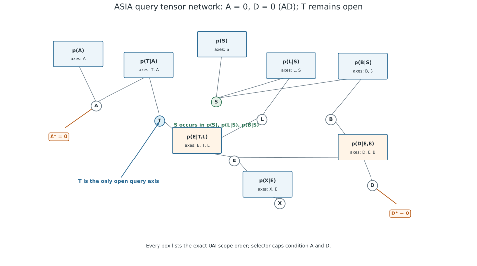
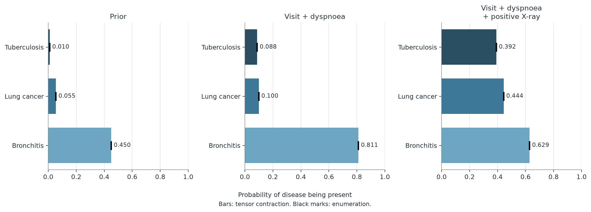
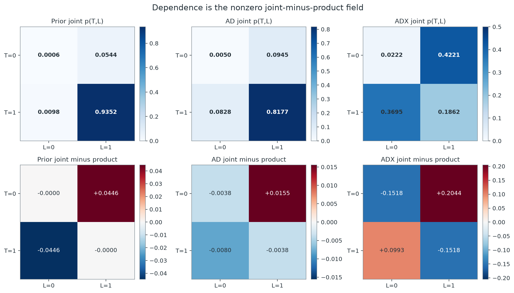
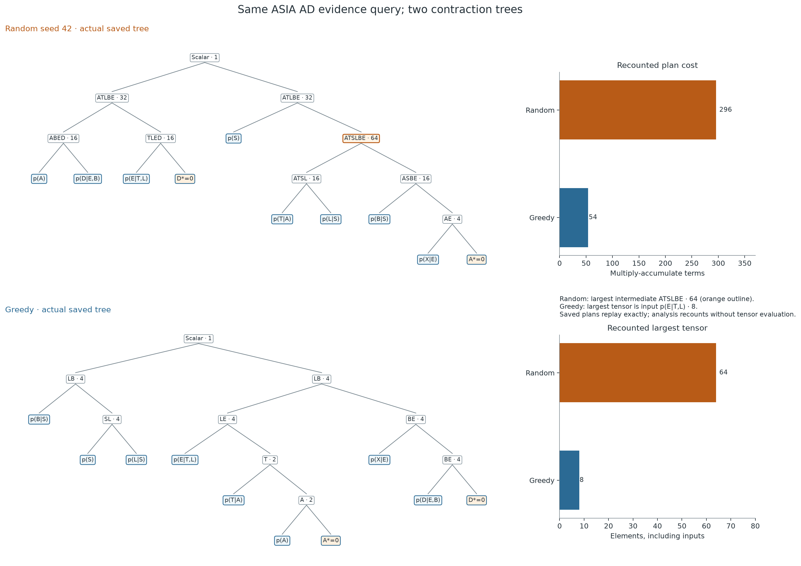
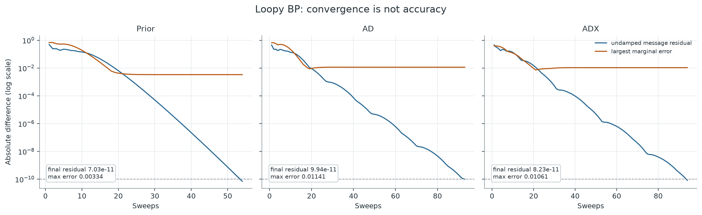
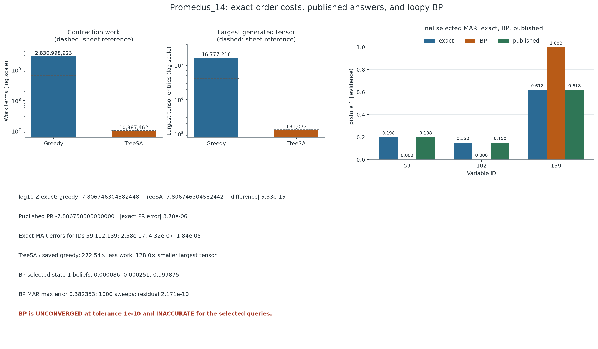
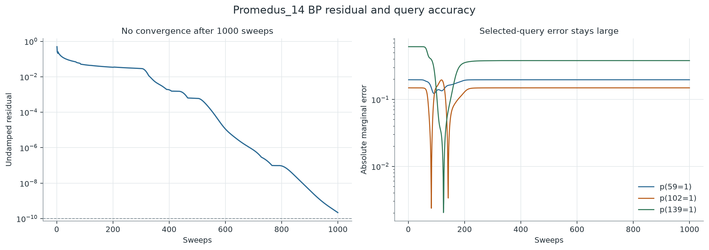

# Week 9: probabilistic inference by tensor contraction

This directory implements every hands-on requirement in the Week 9 learning
sheet: ASIA exact inference by enumeration and tenferro contraction, saved
random/greedy plans with replay and independent analysis, synchronous damped
loopy BP, and the Promedus_14 benchmark with greedy and seeded time-only TreeSA.
Tutorial sketches and optional material are omitted.

Run commands from `week9/`.

## Environment and data

Verified with Rust 1.96.0, `tenferro-{tensor,cpu,einsum}` 0.9.0, omeco 0.2.6,
Python 3.12.14, uv 0.12.9, NumPy 2.5.4 and Matplotlib 3.11.2. Computation is
CPU-only, `f64`, and no autodiff feature is enabled. `curl` and network access
are needed only to restore the pinned data on a fresh checkout.

```bash
make data
make venv
make test
make reproduce
```

Fixed inputs, downloaded by `scripts/download_inputs.sh`:

| input | source and revision | SHA-256 |
|---|---|---|
| `asia.uai` | `TensorBFS/TensorInference.jl@935ed86f8e473f523cac9461c45a1f470e74f0f9` | `0d78314c96b1cbbfd94682f0e99f73461cb50a935a1da85cbc814c70e3fff32d` |
| `promedus/Promedus_14.uai` | `mroavi/uai-2014-inference-competition@22005844423f5bca62798548df808cc418fc0d7d` | `f213b76a7f145a06f39daa9061408981dbd525e4ce2e5156edb83a7073d71349` |
| `Promedus_14.uai.evid` | same revision | `e345a4ebecf02cdd9fdaf42e7456afa5f6ecafa989b6a3c15ef525abe736a403` |
| `Promedus_14.uai.PR` | same revision | `d52ca345f79e79f0385f7bd91a3c2e3521eff165b3dcb7b29be1e56ca5f96dfc` |
| `Promedus_14.uai.MAR` | same revision | `06e3145bb59fd0a22af235af43bc7c45bee71a764647e152314bdded4f0d256f` |

UAI tables retain their original logical scope order. The loader converts the
last-axis-fastest table representation to tenferro's column-major storage without
permuting the named axes. `MARKOV` potentials remain unnormalised and every
intermediate is rescaled by its positive sum with that multiplier accumulated
on a log scale.

## Exact inference and observations

`infer.design.toml` is the complete command/write contract. Exact inference
keeps the eight ASIA tables unchanged and attaches one-hot selector factors for
the observations. BP instead substitutes the observed state directly into every
factor that uses it.

```bash
infer --model asia.uai --evidence prior --out artifacts/prior
infer --model asia.uai --evidence AD --out artifacts/AD
infer --model asia.uai --evidence ADX --out artifacts/ADX
```

Each `run.json` retains full-precision enumeration, contraction, evidence mass,
all node marginals and the `T,L` joint. The stdout also prints the tensor
matrix/trace and three-spin Ising checks.

| case | evidence mass | exact max marginal error | relative evidence error |
|---|---:|---:|---:|
| prior | 1.0 | 1.11e-16 | 2.22e-16 |
| AD | 0.004501375 | 2.22e-16 | 1.16e-15 |
| ADX | 0.00098822675 | 1.11e-16 | 4.39e-16 |

The required errors are both below `1e-10`; every node and joint sums to one.
The direct table check gives `p(T=0|A=0)=0.05` and
`p(T=0)=0.01(0.05)+0.99(0.01)=0.0104`. For ADX,
`p(T=0,L=0)=0.0222140` while the product of marginals is `0.174026`, so the
joint-minus-product evidence is visibly nonzero.

Checks printed by the same binary:

```text
AB = [[4,4],[10,8]], tr(AB) = 12
Z(three-spin Ising ring) = 12.602562098951932
maximum absolute error = 3.55e-15 < 1e-12
```

The Python evidence/test workflow independently forms the two matrices with
`numpy.array`, computes `A @ B`, `np.trace(A @ B)` and an explicit NumPy Ising
sum, then compares against the full-precision tenferro values in `run.json`.
All three NumPy absolute errors are below `1e-12`.







## Contraction orders

```bash
infer --model asia.uai --evidence AD --order random --seed 42 --out artifacts/random
infer --model asia.uai --evidence AD --out artifacts/greedy
infer --model asia.uai --evidence AD --analyze artifacts/random/order.json --out artifacts/analysis
infer --model asia.uai --evidence AD --plan artifacts/greedy/order.json --out artifacts/replay
```

The saved plan includes the binary tree, input/retained labels per node, the
method and seed. `complexity.json` records every union-label pair cost, retained
labels, result size, work and maximum tensor. `--analyze` evaluates no tensor;
`--plan` replays the saved topology. The fixed seed-42 run saved here uses work
296 and largest tensor 64; greedy uses work 54 and largest tensor 8. The random
number generator differs from the sheet's, so its 408/64 reference is
illustrative. Analysis reproduces 296/64 exactly, and replay matches
enumeration within `1e-10`. The greedy maximum, 8 entries, is the input
`p(E|T,L)`; random's largest intermediate is `ATSLBE` with 64 entries.
The Python evidence script independently traverses both saved trees and
recounts every work/largest-tensor value from the recorded labels.

`--seed` is accepted only with `--order random` or `--order treesa`. Exact mode
rejects BP-only flags, and `--analyze` reads and recounts the saved plan without
evaluating tensors or running the matrix/Ising checks.

Greedy uses one `omeco GreedyMethod::default` planning pass. Its saved tree and
recounted cost, rather than an additional restart search, are the evidence.



## Belief propagation

```bash
for case in prior AD ADX; do
  infer --model asia.uai --evidence "$case" --method bp \
    --damping 0.5 --tolerance 1e-10 --max-sweeps 1000 \
    --out "artifacts/bp-$case"
done
```

BP applies observations to factor tables, starts with uniform messages,
normalises every proposal, and updates synchronously. `run.json` stores every
sweep's node beliefs, undamped residual, cumulative factor work and marginal
error. Each distinct sweep is recorded once. The next proposal is computed once;
if it meets tolerance, that same proposal becomes the returned state and record.
The residual is not the damped step size.

| case | returned residual | max marginal error | sweeps |
|---|---:|---:|---:|
| prior | 7.03e-11 | 0.00334 | 54 |
| AD | 9.94e-11 | 0.01141 | 93 |
| ADX | 8.23e-11 | 0.01061 | 94 |

The ADX result matches the sheet's close-but-inexact reference: small residual,
but marginal error remains about `0.01`. Rust tests also check a nonuniform
factor tree where correct BP matches exact marginals and including the
recipient's incoming message fails.



## Promedus_14

```bash
infer --model promedus/Promedus_14.uai --evidence prior \
  --evidence-file promedus/Promedus_14.uai.evid --queries 59,102,139 \
  --out artifacts/promedus-greedy
infer --model promedus/Promedus_14.uai --evidence prior \
  --evidence-file promedus/Promedus_14.uai.evid --queries 59,102,139 \
  --order treesa --seed 2026 --out artifacts/promedus-treesa
infer --model promedus/Promedus_14.uai --evidence prior \
  --evidence-file promedus/Promedus_14.uai.evid --queries 59,102,139 \
  --method bp --damping 0.5 --tolerance 1e-10 --max-sweeps 1000 \
  --out artifacts/promedus-bp
```

The model has 414 binary variables, 414 ternary factors and nine observations.
TreeSA uses only time in its score, seed 2026, three seeded restarts, six trials,
40 iterations per temperature and 180 temperature levels per restart. It starts
from omeco's deterministic Random initializer and the seed also determines every
beta schedule. Repeated seed-2026 runs produce byte-identical `order.json`; every
setting is saved in the plan.

| plan | work | largest tensor |
|---|---:|---:|
| greedy | 2,830,998,923 | 16,777,216 |
| TreeSA | 10,387,462 | 131,072 |

TreeSA uses about 272.54 times less work and a 128 times smaller largest tensor
than this saved greedy run. The two plans agree to `5.33e-15` in `log10 Z` and
`3.33e-16` in query marginals, tighter than `1e-10`.

| quantity | measured | target |
|---|---:|---:|
| exact `log10 Z` | -7.80674630458245 | reference -7.806746304582435 |
| state-1 probabilities for 59,102,139 | 0.1975882582, 0.1497534323, 0.6175220184 | sheet values above |
| published PR error | 3.70e-06 | `<1e-4` |
| published exact MAR max error | 4.32e-07 | `<1e-5` |
| BP state-1 probabilities | 0.0000856, 0.0002508, 0.9998749 | reference approximation |
| BP max selected-query error | 0.382353 | report inaccuracy |
| BP residual after 1000 sweeps | 2.17e-10 | still above `1e-10` |

The final line is reported rather than hidden: Promedus_14 BP is unconverged and
the selected query beliefs are strongly inaccurate. Saved runtimes are recorded
in each `run.json`; the reference run took approximately 1.01 s for greedy,
1.83 s for TreeSA and 1.51 s for the exact-plus-BP comparison, on this machine.





## Verification

`make test` runs Rust tests for all packet contracts plus the Python evidence
checks. The full evidence assertions are also embedded in
`scripts/evidence.py`; `evidence/summary.json` records the measured values used
by the figures.
